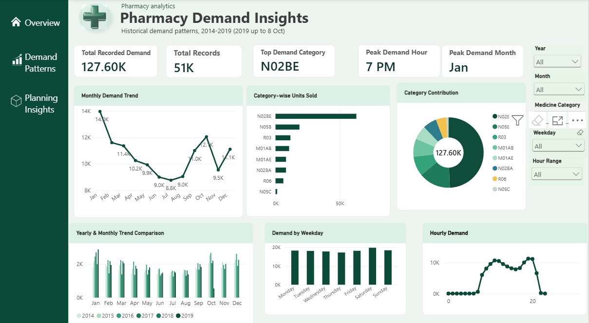

# 💊 Pharmacy Demand Insights

**An SQL + Power BI project that turns six years of pharmacy sales into answers about what sells, when it sells, and how to plan for it.**


*50,532 hourly records · 8 medicine categories · 2014 to Oct 2019 · 5 SQL scripts · 3-page Power BI dashboard*



---

## Table of Contents

[Why This Project](#why-this-project) · [Summary](#summary) · [Business Questions](#business-questions) · [Dataset](#dataset) · [SQL Analysis](#sql-analysis) · [Dashboard](#dashboard) · [Key Insights](#key-insights) · [How to Read the Numbers](#how-to-read-the-numbers) · [Planning Implications](#planning-implications) · [Skills](#skills-demonstrated) · [Future Work](#future-work) · [How to Use](#how-to-use-this-repository) · [Repo Structure](#repository-structure)

---

## Why This Project

A pharmacy that stocks too little loses sales and patients. One that stocks too much ties up cash and risks expiry. Both mistakes come from not knowing the demand pattern.

This project looks at one question: **what does pharmacy demand actually look like across categories, months, weekdays and hours?**

---

## Summary

I analysed hourly pharmacy sales data using MySQL, then built a Power BI dashboard on top of it. The dashboard shows overall demand, category mix, seasonality and the daily rhythm of sales, with filters for year, month, category, weekday and hour range.

| Headline metric | Result |
|---|---|
| Total recorded demand | 127.6K units |
| Total hourly records | 50,532 |
| Top demand category | N02BE |
| Peak demand hour | 7 PM |
| Peak demand month | January |

---

## Business Questions

| Question | Where it is answered |
|---|---|
| Which medicine categories drive demand? | `02_category_analysis.sql`, Category charts |
| Is demand seasonal? | `03_monthly_trends.sql`, Monthly Demand Trend |
| Which hours and weekdays are busiest? | `04_hourly_weekday_analysis.sql`, Hourly and Weekday charts |
| Is the data clean and are the totals consistent? | `01_data_quality.sql`, `05_validation.sql` |

---

## Dataset

Pharmacy sales for 8 medicine groups, identified by ATC code. Four files at different time granularity are in `data/`:

| File | Rows | Granularity |
|---|---|---|
| `saleshourly.csv` | 50,532 | Hourly |
| `salesdaily.csv` | 2,106 | Daily |
| `salesweekly.csv` | 302 | Weekly |
| `salesmonthly.csv` | 70 | Monthly |

The SQL analysis and dashboard use the hourly file. Coverage runs from 2014 to 8 October 2019.

| Code | Medicine group |
|---|---|
| M01AB | Anti-inflammatory (acetic acid derivatives) |
| M01AE | Anti-inflammatory (propionic acid derivatives) |
| N02BA | Pain relief (salicylic acid derivatives) |
| N02BE | Pain relief and fever (paracetamol group) |
| N05B | Anti-anxiety drugs |
| N05C | Sleep aids and sedatives |
| R03 | Asthma and airway drugs |
| R06 | Antihistamines (allergy) |

---

## SQL Analysis

| File | Purpose |
|---|---|
| `01_data_quality.sql` | Checks the raw data before any analysis |
| `02_category_analysis.sql` | Units sold and contribution % per category, using window functions and `UNION ALL` to bring the 8 category columns into one |
| `03_monthly_trends.sql` | Monthly demand, both total and average daily |
| `04_hourly_weekday_analysis.sql` | Demand by hour and weekday, both total and average daily |
| `05_validation.sql` | Reconciles record count and total demand with the dashboard |

---

## Dashboard

Built in Power BI with three pages: **Overview**, **Demand Patterns** and **Planning Insights**.

**Overview page**
- **KPI cards:** Total Recorded Demand, Total Records, Top Demand Category, Peak Demand Hour, Peak Demand Month
- **Charts:** Monthly Demand Trend, Category-wise Units Sold, Category Contribution, Yearly and Monthly Trend Comparison, Demand by Weekday, Hourly Demand
- **Filters:** Year, Month, Medicine Category, Weekday, Hour Range

---

## Key Insights

1. **One category carries the pharmacy.** N02BE accounts for about half of all units sold. N05B is a distant second, and N05C is very small.
2. **Demand is seasonal.** It is highest in January and lowest in the summer months, then climbs again towards October.
3. **Sales follow the working day.** Demand is close to zero overnight and early morning, builds through the day, and peaks around 7 PM.
4. **Weekdays are fairly even.** Saturday is slightly higher than the rest, so weekly demand is steady and weekends are not a slow period.

---

## How to Read the Numbers

November and December have 5 years of data while the other months have 6, because 2019 stops on 8 October. Total demand therefore understates those two months.

To keep the comparison fair, the SQL month and weekday rankings use **average daily demand**, while the dashboard cards and charts show **total demand**. Both views are included so the effect of the uneven coverage is visible.

---

## Planning Implications

These are suggestions based on the patterns above, not results measured in a live store.

- Keep a higher safety stock for N02BE, since it drives about half of demand.
- Build up stock ahead of the January peak and plan lower orders for summer.
- Schedule staff around the busy hours in the late afternoon and evening.
- Review slow-moving categories such as N05C so that cash is not tied up in stock that sells little.

---

## Skills Demonstrated

| Category | Skills |
|---|---|
| **SQL (MySQL)** | Window functions, `UNION ALL`, aggregation, date and time functions, data validation |
| **BI and Visualisation** | Power BI dashboard design, KPI cards, slicers, multi-page navigation |
| **Analytics** | Seasonality analysis, category contribution, hourly and weekday patterns |
| **Data Quality** | Reconciling SQL output with dashboard totals, handling uneven time coverage |
| **Domain** | Pharmacy retail demand and inventory planning |

---

## Future Work

- Add demand forecasting for the next months by category.
- Add a table-creation script (`00_setup.sql`) so the project runs end to end from the CSV files.
- Publish the dashboard to Power BI Service and add a public link.
- Extend the data-quality checks to NULL values, negative values and duplicate timestamps.

---

## How to Use This Repository

1. Download `dashboard/pharmacy_demand_dashboard.pbix` and open it in [Power BI Desktop](https://powerbi.microsoft.com/desktop/) (free).
2. To reproduce the SQL results, load `data/saleshourly.csv` into MySQL and run the files in `sql/` in order, 01 to 05.

---

## Repository Structure

```
pharmacy-demand-analysis/
├── README.md
├── sql/
│   ├── 01_data_quality.sql
│   ├── 02_category_analysis.sql
│   ├── 03_monthly_trends.sql
│   ├── 04_hourly_weekday_analysis.sql
│   └── 05_validation.sql
├── dashboard/
│   ├── pharmacy_demand_dashboard.pbix
│   └── dashboard_preview.png
└── data/
    ├── saleshourly.csv
    ├── salesdaily.csv
    ├── salesweekly.csv
    └── salesmonthly.csv
```

---

**Swarnalipi Sahu** · Aspiring Data Analyst · SQL · Power BI
[LinkedIn](https://www.linkedin.com/in/swarnalipi)
